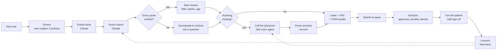
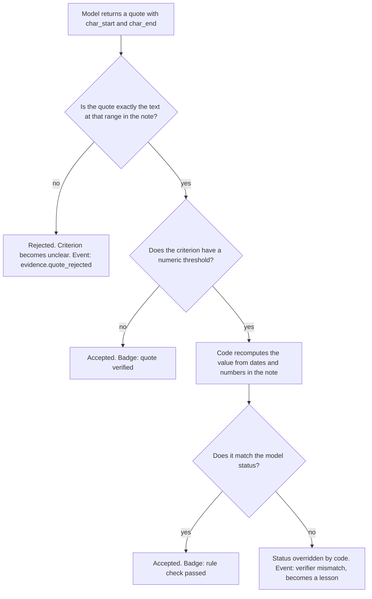
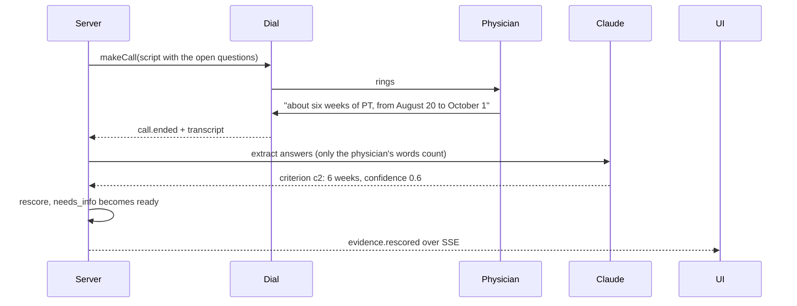
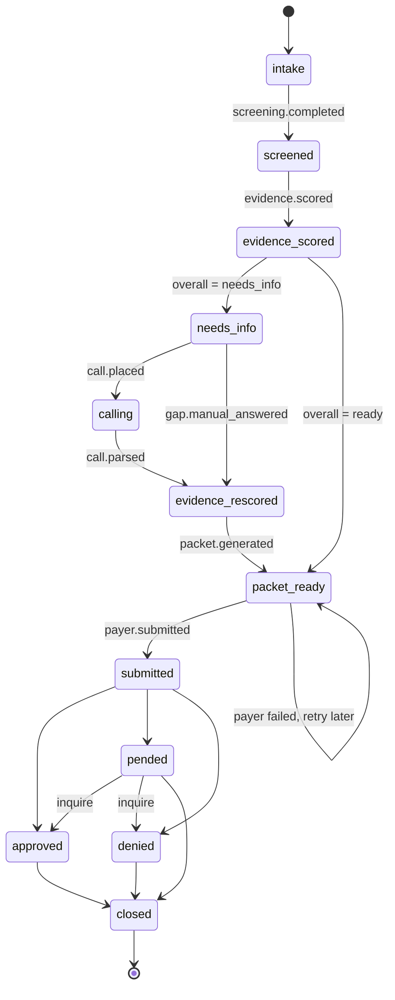
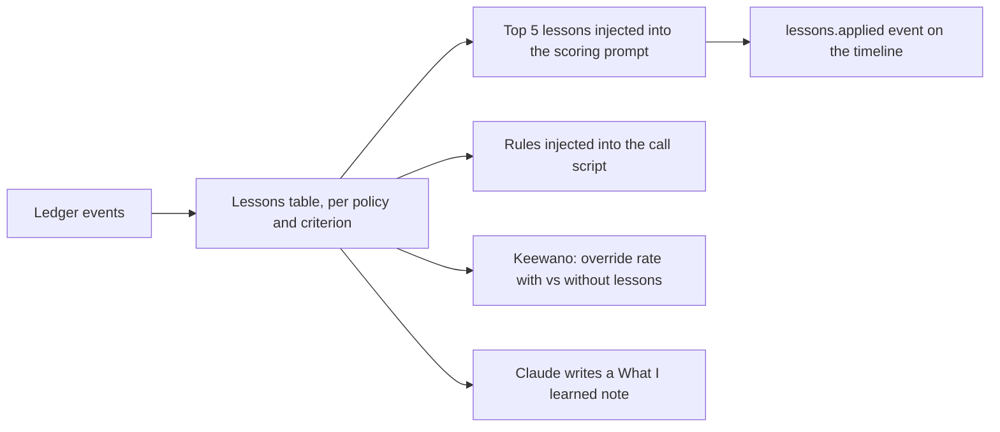
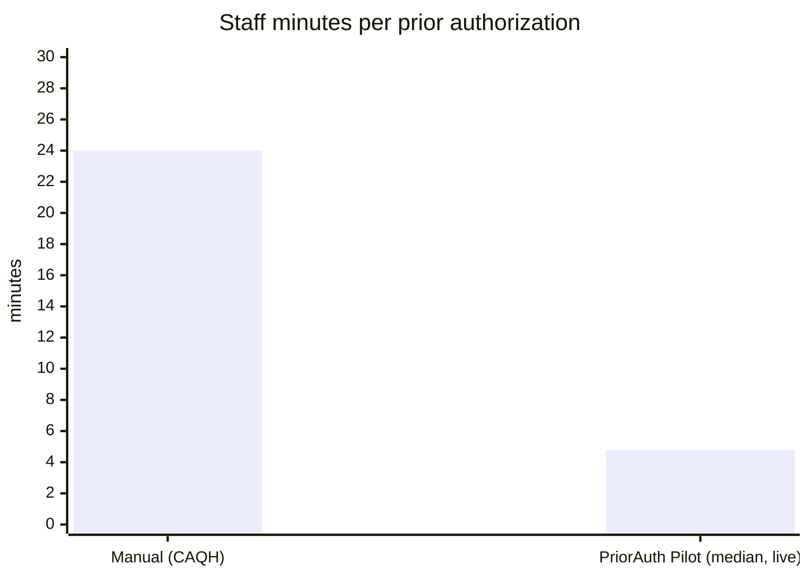
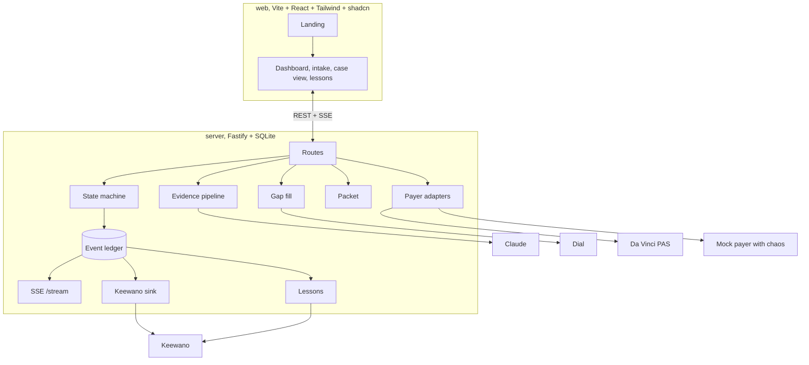

# PriorAuth Pilot

I built this in one day at SpeedHacks (October 11, 2026, San Francisco). The challenge was "give people their time back". I picked prior authorization because I have watched clinic staff lose half an hour per request to the same loop: read the note, find the payer policy, hunt for the sentence that proves each criterion, call the doctor for whatever is missing, write the letter, fax it, wait.

PriorAuth Pilot does that loop for them. It reads the visit note, proves every payer criterion with a quote it can point to in the note, phones the physician for what is missing, builds the packet, submits it, and then learns from the corrections staff make so the next case is better.

Manual prior auth costs about 24 minutes of staff time per request (CAQH Index). With this tool the staff review step takes about 5 minutes. Both numbers are on the dashboard and the second one comes live from Keewano.

## How it works



Every step writes an event to a ledger. The case view shows that timeline so staff can see exactly what the system did and why.

## How process works:

An LLM that scores medical criteria will happily invent a sentence that sounds like the note. I did not want that anywhere near a payer submission. So every quote the model returns has to pass two gates before it counts.



In the UI each criterion row shows "quote verified" and "rule check passed" badges, and the quote is highlighted in the note at the exact character range.

## The phone call

When the note is missing something, the system calls the ordering physician. This is a real call through Dial. I tested it live during the hackathon: 63 seconds, one question, answer parsed, case rescored, 95 seconds from scoring to ready.



The voice agent said it would also document ibuprofen and rest, which the physician never said. The transcript parser flagged it, the verifier only accepted the physician's own words, and the letter cites only those. That incident is now a stored lesson and the next call script for that policy carries a rule against it. More on that below.

## Case lifecycle



## It learns from its mistakes

Our system allows the AI to learn from its past mistakes without outside support. Four kinds of mistakes become lessons, with no engineer involved.

| Source of the lesson | What happened | What changes next time |
|---|---|---|
| Reviewer override | Staff changed a criterion status and gave a reason | The scoring prompt for that policy gets a "known pitfalls" block |
| Rejected quote | The model quoted something that was not in the note | Same, with the pattern that failed |
| Verifier mismatch | Code recomputed a number and disagreed with the model | Same, telling the model to compute from the facts first |
| Call overstep | The voice agent claimed something the physician did not say | The next call script gets a mandatory rule against it |



The first version of a lesson said "look harder for therapy duration". That pushed the model to guess the criterion was met. The code verifier caught it and downgraded it. I rewrote the lesson wording to forbid inference, and on the next case the model got it right by itself. So the loop learns, and the verifier keeps learned pressure from turning into guessing. The honest gap: criteria with no numeric check have no verifier backstop yet.


## Time saved



| | Minutes |
|---|---|
| Manual, CAQH Index baseline | 24 |
| PriorAuth Pilot, median staff review, live from Keewano | 4.8 |
| Live physician call, measured | 1.05 |
| Scoring to ready including the call | 1.6 |

The median comes from a live Keewano query over the event ledger. The history behind it is 41 cases, 40 of which are clearly labelled synthetic backfill so the number has a base. Live cases are tagged separately and the dashboard says so.

## What is real and what is mocked

| Step | Status |
|---|---|
| Screening against 6 insurer policies | Real |
| Extraction and scoring | Real, Claude Sonnet 5.5 |
| Quote verification and rule checks | Real |
| Physician phone call | Real, Dial, tested live |
| Letter, PDF, HL7 FHIR Da Vinci PAS bundle | Real |
| Payer submission | The live Da Vinci reference server accepts the bundle and returns pended. Approved and denied use a mock adapter with injected 500s, timeouts, retries and a circuit breaker |
| Patient text | Simulated, needs a second Dial number |
| Live analytics and learning metric | Real, Keewano |
| Lessons loop | Real |
| Sign in | Demo only, local |

## Architecture



## Partner tools

- Dial for the outbound voice call, transcript and event stream.
- Keewano as the event store behind the live metrics and the learning effect measurement, queried over its MCP server with SQL.
- Anthropic Claude for extraction, scoring, the letter, transcript parsing and the lessons summary.
- HL7 Da Vinci PAS for the standards based bundle and the live reference server submission.

## Run it

Node 24. A fresh clone installs without build tools.

```bash
cd server
npm ci
cp .env.example .env    # ANTHROPIC_API_KEY, DIAL_*, KEEWANO_* as needed
npm run dev             # port 4000
npm test                # 65 tests

cd web
npm ci
npm run dev             # port 5173
```

Without keys you still get screening, template letters, the mock payer and the whole UI. Scoring needs ANTHROPIC_API_KEY. The call needs DIAL_API_KEY, DIAL_FROM_NUMBER_ID and PHYSICIAN_PHONE, and every call is real and billed. Live analytics need KEEWANO_API_KEY and KEEWANO_PAT. Sign in with "Continue with demo account".

## Repo layout

- `server/` ledger, state machine, rules, evidence pipeline, Dial, packet, payer adapters, Keewano sink, learning loop. `server/RESEARCH.md` has the design decisions I made along the way.
- `web/` landing, demo auth, dashboard, intake, case view, lessons.
